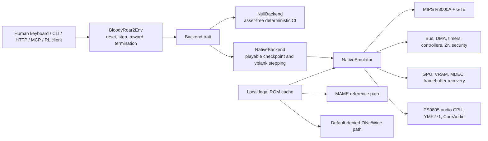

# BloodyRoar2 Codex Session Archive

This directory documents the long-running Codex thread that built
`BloodyRoar2-rust` into a macOS-first Rust emulator and agent-control harness.
The human-readable documents are summaries. The ignored Zstandard archive is
the lossless source of truth and preserves every byte of the original JSONL.

## Scope

- Project: `/Users/jinminseong/Desktop/BloodyRoar2-rust`
- Session ID: `019ed623-4296-79f2-a751-ff3cec538edc`
- Source file:
  `/Users/jinminseong/.codex/sessions/2026/06/18/rollout-2026-06-18T00-11-35-019ed623-4296-79f2-a751-ff3cec538edc.jsonl`
  (deleted after the verified archive and audit completed)
- Session metadata time: `2026-06-17T15:11:35.574Z`
  (`2026-06-18 00:11:35 KST`)
- First/last JSONL events: `2026-06-17T15:14:23.970Z` through
  `2026-08-07T14:08:10.676Z`
  (`2026-06-18 00:14:23 KST` through `2026-08-07 23:08:10 KST`)
- Repository commits produced during the thread: 46
- Deletion boundary: only the exact source file above may be removed. No
  wildcard, parent-directory cleanup, or other Codex session deletion is
  permitted.

## Preservation Result

| Artifact | Purpose | Records/size | SHA-256 |
| --- | --- | --- | --- |
| Lossless `.jsonl.zst` | Exact original JSONL bytes | 634,119,614 bytes | `f25546b39bbfe183e1b3e9149912793727a2a39f225b0641a2d475e6d004e757` |
| Source JSONL identity | Restoration target | 845,307 lines, 16,252,314,249 bytes | `34d9f9e49e7d5bdea008c792ddc1a322ff736bc9842e5aaff40ef48fde212da6` |
| `messages.jsonl.gz` | Searchable user/assistant messages | 132,724 records | `5a7eddd269459e4b3195e84149f21719eae6c836393dd928452d321a2e629d1a` |
| `compactions.jsonl.gz` | Searchable handoff/compaction summaries | 2,611 records | `f5af6aaf1577ac94969cc3a60d15c8e2ab8e7f0a91410b21c6229446303dd1d6` |
| `tool-events.jsonl.gz` | Calls, patches, commands, and output evidence | 456,349 records | `6c67726565b59f7420beb7e8d7568b3a8d692cc59398c93dc6243a42ccb68de3` |
| `event-manifest.tsv.gz` | Per-source-line timestamp/type/hash index | 845,308 lines including header | `2b1049784646e9824e3eca4b07880675c602c51db9aeb38d9e8f37d7195ff0d1` |

The lossless and semantic files are stored under:

```text
.runtime-cache/session-archives/019ed623-4296-79f2-a751-ff3cec538edc/
```

The directory is Git-ignored and mode `0700`; archive files are mode `0600`.
The exact archive contains all original bytes, including one secret-shaped
value repeated in three tool outputs. The semantic archives replace those
occurrences with a redaction marker containing only type, byte length, and
SHA-256. Treat the exact archive as sensitive local data.

The source JSONL was deleted at `2026-08-08T16:07:33Z` after its SHA-256 and
the decompressed archive SHA-256 both matched the value above. All 6,180 other
session files present before deletion remained at the same path and inode. Two
new Codex session files appeared in the immediate post-delete snapshot and
were left untouched. Later checks continued to show zero missing or
inode-changed preexisting sessions while the Codex runtime added further
session files. No key pattern was found in the tracked worktree, any local Git
object, or the current remote `main` commit.

## Original Objective

The user asked for one end-to-end result:

- Statistically inspect an untrusted Windows Bloody Roar 2/ZiNc bundle without
  executing it.
- Adapt the project for Apple Silicon macOS in Rust.
- Make the real game playable through a native window rather than stopping at
  a mock harness.
- Expose deterministic Gymnasium-style action, observation, reset, and frame
  stepping semantics for RL and LLM agents.
- Add HTTP and MCP control surfaces.
- Keep ROMs, BIOS data, EXEs, DLLs, ZIPs, captures, and other proprietary assets
  outside Git.
- Connect and push source-only work to
  `https://github.com/NomaDamas/BloodyRoar2-gym.git`.
- Repeatedly test rendering, input, gameplay transitions, performance, and
  audio instead of declaring completion from compilation alone.

## Capability Boundaries



| Layer | Runtime responsibility | Abstraction level |
| --- | --- | --- |
| CLI, HTTP, MCP | Validate requests and expose actions, observations, screenshots, diagnostics, named moves, and sequences | Agent-facing |
| `BloodyRoar2Env` | Enforce frame bounds, calculate rewards, aggregate sequences, and track termination/truncation | Gym-style environment |
| `Backend` | Separate agent APIs from emulator implementation | Stable adapter contract |
| `NativeBackend` | Restore a playable checkpoint, apply P1/P2 buttons, advance by vblank, read HUD state, and emit 640x480 screenshots | RL-grade native adapter |
| `NativeEmulator` | Coordinate CPU, bus, GPU, input, display selection, sound, diagnostics, and cloning | Machine runtime |
| Native hardware modules | Emulate CPU/GTE, DMA, GPU/VRAM, MDEC, timers, controller/ZN I/O, security devices, and sound hardware | Hardware-oriented |
| MAME and ZiNc helpers | Provide external compatibility/reference paths without becoming the RL backend | Optional compatibility |

## Delivered Project State

### Security and legal handling

- The initial archive was inspected statically; bundled Windows executables and
  plugins were not run.
- Split-ZIP and proprietary-content risks were documented in
  `docs/SECURITY_REVIEW.md`.
- `.gitignore` excludes runtime assets and generated evidence.
- ZiNc execution through Wine is default-denied unless
  `BLOODYROAR2_ALLOW_UNSAFE_ZINC_WINE=1` is explicitly set.
- MAME remains an optional reference. The Rust-native path is the primary
  Apple Silicon target.

### Agent and Gym interfaces

- The action space contains 38 discrete P1/P2 actions and also accepts arbitrary
  simultaneous button objects.
- `BloodyRoar2Env` implements reset, bounded frame stepping, reward,
  termination, truncation, timed action sequences, and character selection.
- Observations expose frame number, both health bars, both Beast meters, round
  time, terminal state, playability, render/effect/audio progression,
  emulated FPS, checksums, diagnostics, and optional screenshots.
- HTTP endpoints include index, action/character/observation spaces, health,
  diagnostics, screenshot, reset, step, named action, and step sequence.
- MCP exposes the same environment through asset-free and native stdio
  runtimes.
- `NullBackend` keeps API and client development independent of proprietary
  assets. `NativeBackend` clones real character-select and playable-match
  checkpoints for deterministic resets.

### Native emulator and play path

- A Rust-native machine path was built around a MIPS R3000A/GTE CPU, memory bus,
  interrupts, DMA, GPU/VRAM, MDEC, timers, controllers, ZN security devices,
  CD/SPU stubs, PS9805 sound CPU, YMF271 synthesis, and macOS CoreAudio output.
- Native commands cover ROM inspection, compatibility reports, cache
  preparation, stepping, screenshots, traces, scripted probes, health/input
  checks, GUI/manual/autoplay, HTTP, MCP, all-roster QA, and stage QA.
- The native backend reaches a real playable checkpoint once and clones it for
  reset/character-selection operations instead of cold booting every episode.
- Physical and automated P1/P2 controls are mapped separately so test input
  cannot be mistaken for physical-keyboard proof.

### Rendering and input work

- Full-height output replaced early top-half-only presentation.
- Warning/title/FMV frames were separated from playable combat frames.
- Field composition, deinterlacing, viewport selection, aspect correction, and
  stable-frame handoff were iterated repeatedly.
- GPU DMA parsing, texture-page and CLUT selection, stage/background recovery,
  character-select portrait recovery, fighter-model recovery, stale replay
  invalidation, and blocking-artifact classifiers were added.
- Coin/start acceptance became guest-feedback driven rather than relying on
  sparse polling.
- GUI focus, AppKit activation, input latching, release edges, P1/P2 activity
  counters, and requested-button verification were added.
- Rendering gates reject black transitions, warning pages, texture atlases,
  red/salmon palette corruption, cropped fields, stale title overlays, missing
  scene detail, and several repeated-tile/ghosting patterns.

### Startup, cache, and performance work

- Repeated external ZIP extraction was replaced by an ignored materialized ROM
  cache keyed by source identity.
- `.runtime-cache/native-rom-cache/LATEST_ROM_DIR` records the active
  materialization.
- Startup probes compare tracked and optimized hidden-boot paths.
- CPU dispatch, framebuffer rasterization, display analysis caches, recovery
  replay, capture encoding, and GUI pacing were profiled and optimized.
- `native-play` fast-forwards warnings, then opens at the title screen for
  physical input. `native-autoplay` retains the scripted full-entry path.

## Failure and Fix Record

| Observed failure | Root cause or diagnosis | Durable response |
| --- | --- | --- |
| Only the upper half of the GUI was visible | Field-composed 512x480 output lost to promoted 240-line candidates | Full-height composition and regression gates |
| Warning pages or red/salmon textures appeared as gameplay | Over-broad display promotion and weak playability classification | Stable candidate selection and blocking-artifact classifiers |
| Character select showed an enlarged box/atlas instead of the portrait | Missing/stale portrait texture and CLUT provenance | Retained transfer evidence, exact/verified portrait replay, roster QA |
| Combat backgrounds or fighters disappeared | Missing GPU packet/texture recovery and stale replay lifetime errors | OTC/unlinked primitive recovery, packet provenance, fighter/stage gates |
| Keys appeared unresponsive except Escape | Window focus, sparse guest polls, and coin/start edge handling | AppKit activation, latched input, guest counters, feedback-driven entry |
| Boot was repeatedly slow | ZIP reopening/materialization and long tracked startup | Persistent ROM cache and optimized startup handoff |
| Beast could freeze CPU/GPU progress | Guarded unaligned-load recovery gap around a late-game runtime path | Signature-guarded CPU recovery plus regression/runtime checks |
| Gameplay ran too slowly for audio | Heavy recovery/raster work reduced wall-clock frame production | Profiling, CPU/GPU fast paths, raster caches, queue pacing, explicit QA gates |
| Audio generated PCM but starved CoreAudio | Producer could not sustain callback consumption | Queue telemetry, adaptive pacing/concealment, health classification, live QA |
| “Pass” results conflicted with visible corruption | Gates trusted a single checksum/classifier | Multi-stage PNG, telemetry, input, timing, and scene-detail validation |

## Validation History

The thread repeatedly ran `cargo fmt`, `cargo test`, release builds, clippy,
scripted real-ROM probes, snapshots, GUI captures, HTTP/MCP smoke tests, and
macOS live QA. Test counts rose as the emulator expanded; they are historical
snapshots, not a promise that every later dirty tree retained the same count.

- Early foundation: deterministic null backend, CLI/HTTP, security review, MAME
  and ZiNc diagnostics.
- June native-core loop: CPU/GTE/MDEC/GPU transfer fixes, full-height display,
  input checks, health checks, and playable-state classification.
- July rendering loop: character select, combat, stage/fighter texture
  recovery, checkpoint reset, GUI input proof, startup and performance work.
- Late July/August: P1/P2, Beast recovery, sound emulation, CoreAudio,
  all-roster/stage QA, HTTP/MCP agent APIs, and resource cleanup.
- The final committed handoff recorded 1,715 Rust library tests passing with 2
  ignored, 394 Rust binary tests passing, 60 Python QA tests passing with 6
  skipped, and release clippy passing with `-D warnings`.

## Post-Archive Continuation

The source JSONL ends on `2026-08-07 23:08 KST`. Work performed on
`2026-08-08` is not part of that source session and remains uncommitted across
12 implementation/documentation files. It adds deeper roster/stage rendering
work, sound-core changes, and `BR2_NATIVE_DISABLE_AUDIO=1`.

Latest preserved continuation evidence:

- `qa-summary-20260808-224406.json`: build passed; the 5,136-frame headless
  smoke path passed.
- The same run's live GUI path failed after the window closed at frame 291, so
  selection, combat, Beast, input, and performance verification did not finish.
- CoreAudio started and PCM was nonzero, but health was
  `realtime_starved` because the queue underflow ratio exceeded the gate.
- Manual visual QA should currently use `BR2_NATIVE_DISABLE_AUDIO=1` until the
  live audio pacing failure is fixed.

Do not present the current dirty tree as fully live-validated. Do not revert it
while using this archive.

## Archive Navigation

- `CHRONOLOGY.md`: phase history and all 46 project commits.
- `ARCHIVE_MANIFEST.md`: checksums, redaction policy, restoration, validation,
  and deletion audit.
- `inventory.json`: machine-readable source/event/tool statistics.
- `../qa-evidence/`: two preserved post-session QA summaries.
- `../../../PROJECT_HANDOFF.md`: concise current operational handoff.
